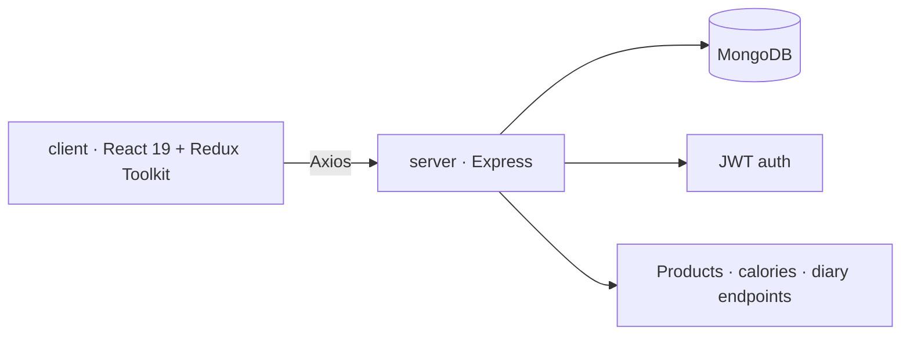

<div align="center">



<p>
  <a href="https://goit-slim-moms.vercel.app"></a>
  
  
  
</p>

<p><em>A full-stack web app for tracking daily calorie intake, with personalised recommendations<br>
based on height, weight, age and blood type. Built as a GoIT team project.</em></p>

<table>
  <tr>
    <td width="50%"></td>
    <td width="50%"></td>
  </tr>
</table>

</div>


## Features

| | |
|---|---|
| **Quick calculator** | A public form that works out your daily calorie goal from height, current and desired weight, age and blood type. |
| **Personal results** | A modal with your goal and the foods not recommended for your blood type. |
| **Accounts** | Registration and login, with the session persisted through Redux Persist. |
| **Diary** | A daily food log with a date picker: add and remove products and watch calories update in real time. |
| **Calculator page** | Save your calorie goal to your profile. |
| **Sidebar** | Today's goal, what you have eaten and the foods to avoid. |




## Türkçe özet

**Slim Moms**, günlük kalori alımını takip eden ve boy, kilo, yaş ve kan grubuna göre kişisel öneriler veren full-stack bir web uygulaması. Herkese açık hesaplayıcı, kişisel sonuç ekranı, tarih seçmeli yemek günlüğü ve kan grubuna göre önerilmeyen yiyecekler listesi var. GoIT eğitimi kapsamında ekip projesi olarak geliştirildi; backend tarafında ürün, kalori ve günlük uç noktalarını yazdım.


## Development

```sh
cd server && npm install && npm run dev     # API
cd client && npm install && npm run dev     # web app
```

See `SETUP.md` for environment variables and `CONTRIBUTING.MD` for the team workflow.

<div align="center">
<br>
<a href="https://github.com/kutluhangil"></a>
<sub>Fork of <a href="https://github.com/goit-nodejs-project/SlimMoms">goit-nodejs-project/SlimMoms</a> · a GoIT Full Stack team project.</sub>
</div>
