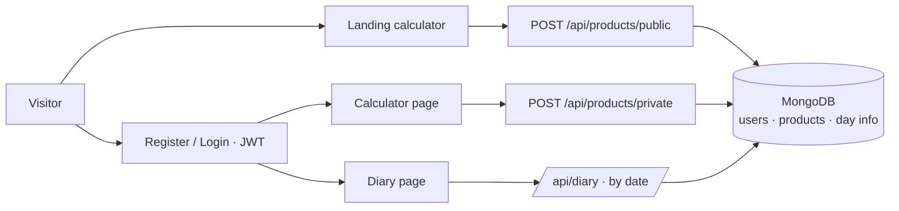

<div align="center">


<p>
  <a href="https://goit-slim-moms.vercel.app"></a>
  
  
  
</p>

<p><em>A full-stack web app for tracking daily calorie intake, with a personal daily goal,<br>
a dated food diary and the foods to avoid for your blood type.</em></p>

<table>
  <tr>
    <td width="50%"></td>
    <td width="50%"></td>
  </tr>
  <tr>
    <td width="50%"></td>
    <td width="50%"></td>
  </tr>
</table>

</div>


## The idea

Slim Moms answers two questions for someone trying to lose weight: how many calories a day should I aim for, and what did I eat today? Anyone can try the calculator on the landing page; signing in saves the goal to the profile and opens a diary where every day has its own list of foods and a running total against the goal.

> **A transparent formula.** The daily goal is `10 × desired weight + 6.25 × height − 5 × age − 161`, calculated on the server. The same request returns the foods marked as not recommended for the user's blood type in the product database.


## Features

| | |
|---|---|
| **Quick calculator** | On the landing page: height, current and desired weight, age and blood type; a modal shows the daily goal and foods to avoid. |
| **Accounts** | Register, log in and log out with JWT; the token is persisted with Redux Persist and validated on the server. |
| **Saved goal** | The calculator page saves the goal to your profile. |
| **Food diary** | Pick a date, search products by name, add them with grams and remove them; calories add up as you go. |
| **Summary sidebar** | Calories left, consumed, the daily rate and the percentage of normal, plus the foods not recommended for you. |
| **API docs** | Swagger documentation for the auth, product and diary routes. |


## How it fits together



| Route group | Endpoints |
|---|---|
| `GET /api/health` | Server status |
| `/api/auth` | `POST /register` · `POST /login` · `POST /logout` · `GET /current` |
| `/api/products` | `GET /?q=` search · `POST /public` calculate (not saved) · `POST /private` calculate and save |
| `/api/diary` | `GET /:date` · `POST /` add a product · `DELETE /:dayInfoId/:productId` |

| Page | Route | Access |
|---|---|---|
| Landing with calculator | `/` | Public |
| Log in · Register | `/login` · `/register` | Public only |
| Diary | `/diary` | Private |
| Calculator | `/calculator` | Private |


## My part

I built the backend's product, calorie and diary endpoints: product search, the public and private calorie calculations with blood-type filtering, and adding and removing diary entries (including the 201 / 200 distinction when an upsert creates or updates a day), then applied the team lead's review feedback.


## Türkçe özet

**Slim Moms**, GoIT eğitimi sırasında ekip olarak geliştirdiğimiz tam yığın bir kalori takip uygulaması. Boy, kilo, hedef kilo, yaş ve kan grubuna göre günlük kalori hedefini (10 × hedef kilo + 6,25 × boy − 5 × yaş − 161) hesaplıyor, kan grubuna göre önerilmeyen yiyecekleri listeliyor ve tarihli bir besin günlüğü tutuyor. Ön yüz React 19 ve Redux Toolkit, arka yüz Express 5 ve MongoDB; Swagger belgeleri var. Ben backend'de ürün, kalori ve günlük uç noktalarını yazdım.


## Development

```sh
cd server && npm install && npm run dev     # API on :5000
cd client && npm install && npm run dev     # web app
```

The server reads `MONGO_URI`, `JWT_SECRET`, `JWT_EXPIRES_IN` and optionally `PORT`; the client reads `VITE_API_URL`. See `SETUP.md` for details and `CONTRIBUTING.MD` for the team workflow.

```
client/src/   pages, components, redux (auth, diary, calculator), api
server/       app.js, routes, controllers, models (User, Product, DayInfo), middleware, docs (Swagger)
screenshots/  the pages above
```

<div align="center">
<br>
<a href="https://github.com/kutluhangil"></a>
<sub>Fork of <a href="https://github.com/goit-nodejs-project/slim-moms">goit-nodejs-project/slim-moms</a> · a GoIT Full Stack team project · the numbers in the banner are a worked example.</sub>
</div>
